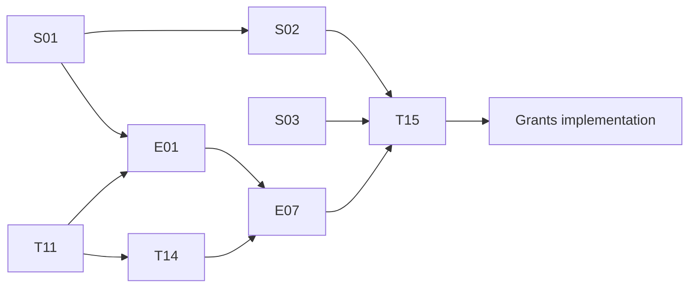

# Publication stabilisation: execution handoff

## Current disposition — 31 October 2026

The selected essential publication workflow is accepted. T11/T14/T15/E01/E07
have scoped reconciliation in their original plans/metadata; this September
execution sequence is preserved history and does not reopen those exits.
PR98 delivers isolated full retained PubMed and candidate grant-reference cloud
outputs. Existing native retained-reader code/wiring is implemented; runtime
adoption proof is distinct from an unfinished feature. See the
[current handoff](../handoff/CURRENT_STATE.md) and
[feature-only remaining scope](../docs/CURRENT_MISSING_OUTCOMES.md#feature-only-remaining-scope--31-october-2026).
Keep the existing 1 November verification and optional deferrals. Use current
one-test/one-verify cadence; do not execute the historical broad-test commands
below as new requirements.

## Historical stabilisation handoff

Planning baseline: 2026-09-20. User requested detailed tracks first, suitable for a smaller implementation model. This package plans the work; creation of a plan does not complete its tasks. Grant planning can remain in place; grant implementation follows the accepted publication baseline.

## Start here

Read the mandatory entry files and CURRENT_STATE, then run:

```sh
git status --short
python3 scripts/agent_harness.py context --task publications
python3 scripts/validate_conductor.py
```

Start [S01](archive/S01_publication_stabilisation/plan.md), task S01.1.1. Read-only baseline work may run in parallel with [S03](archive/S03_private_github_sync/plan.md) privacy inventory. Do not run the current release packager before its privacy defects are fixed: it embeds .git and bundles all history.

## Ownership and order

| Owner track | Responsibility | Required before execution/closure |
|---|---|---|
| S01 | Attribution defects, flow structure, report scope | Current local baseline; native inventory before scope migration |
| S02 | Build identity, source manifests, safe packaging, native recovery documentation | S01; runtime checks additionally require actual target access |
| S03 | Privacy cleanup, source history choice, private GitHub sync | Exact candidate scan and resolved history strategy before upload |
| T11 | Committed history, native parser/storage integration and consecutive cycles | Existing isolation evidence and tested local definitions |
| E01 | Actual flow execution and schedule status | S01 and T11; T14 export proof before schedule activation |
| T14 | Complete native exports and monthly replay | Accepted source/model batch from T11 |
| E07 | List invariants, enrichment backfill, monitoring and key reconciliation | S01, T11 and E01; export comparison uses T14 output |
| T15 | Integrated acceptance, recoverable release and grants handover | S01/S02/S03/T11/T14/E01/E07 evidence |



## Task execution protocol

1. Read the selected task's inputs and dependency evidence, then inspect current files and platform state where relevant. Existing checked boxes are historical claims, not substitutes for current evidence.
2. Record the exact edit scope in the track review. Preserve unknown/unrelated work. If needed, use a separate working copy; never reset the user's dirty checkout.
3. For behavioural changes, write a failing counterexample before the fix. Run the focused test; confirm it fails for the intended reason. Implement the smallest complete fix, then rerun it.
4. Use synthetic fixtures only in local/isolated test targets. No fabricated tenant receipts and no live publication rows replaced by fixtures.
5. Run `python3 scripts/agent_harness.py check --task all` at each completed local phase. Expected exit code is zero and PASS_LOCAL_ONLY; record failures without changing frozen baselines merely to pass.
6. For native tasks, discover actual supported tool schemas/UI controls. Before a write, confirm identity, current revision, consumers and recoverable isolation. Read back after saving and reload to prove persistence. A query response or import acknowledgement is not a write/refresh certificate.
7. Capture private evidence with task ID, UTC time, target IDs, source commit/definition hashes, input/output hashes, run correlation, expected/observed result and rollback reference. Track review contains safe paths and conclusions only.
8. Update only the completed checkbox. Record command/result, known limits and the next executable task. At a blocker, continue independent work but stop dependent mutations. No repetitive approval requests for already-authorised routine work.

## Explicit boundaries

- Existing user authority covers local fixes, these plans, safe discovery and preparing private GitHub synchronisation. Determine the latest history-strategy decision before upload; preserve original local history.
- AGENTS.md requires specific approval for sharing, publishing, schedules, purchases and existing-VM changes. Check prior session authority before requesting it; an unspecified future approval cannot be invented.
- Same report/model does not mean permission to overwrite a shared original. Verify the established isolation/rollback path.
- T16/T17 remain dormant fallbacks. Missing authentication or a missing plugin is not permission to start them.
- No added project-management service is required. Use Conductor, Git and optional GitHub Releases; native platform versioning is capability-dependent.

## Handoff acceptance

No global “complete” declaration until T15 records independent source, native, rendering, export, recovery and delivery outcomes. Explicitly distinguish tested manual operation from unattended scheduling. A scope deferral requires the owner's decision and remains documented as a deferral.

New source release tags are created only after verification of the exact commit and artefact hashes. GitHub source releases exclude tenant identities, raw exports and caches. Private restoration snapshots are separate from GitHub source packages.
